# iowa-fatal-crashes

Fourteen charts of the fatal crashes on Iowa roads since 2015, built from Iowa Data Hub crash data.
The scripts, data extracts and charts were first written in the
[mice-algorithm](https://github.com/SateeshPatlolla/mice-algorithm) repo.

## Layout

| Folder | What is in it |
|---|---|
| `R/` | One script per chart, three `*_extract.R` scripts that rebuild the data, and `packages.R` |
| `data/` | The CSV extracts the charts read, and a zip of Census road lines for the two road maps |
| `output/` | The charts (PNG) and a 500 px thumbnail of each |
| `docs/` | How each chart is built and how to check a rebuild |

## Run

Run everything from the project root.

```r
renv::restore()                  # installs the package versions in renv.lock
source("R/iowa_fatal_crashes.R") # or any other chart script
```

Every script starts with `source("R/packages.R")`, which loads all the packages the project uses.
The chart scripts need internet for Natural Earth shapes and Google Fonts.

## Iowa fatal crashes

`R/iowa_fatal_crashes.R` uses [Drivers and Vehicles Involved in Iowa Crashes](https://data.iowa.gov/catalog/dataset/17)
to map the 3,586 fatal crashes recorded from 2015 to early October 2026. Dots are coloured by the main cause,
diamonds mark the 12 crashes that killed four or more people, the loupe zooms into the Des Moines area, and the
raincloud shows driver age by cause. The grey lines are Iowa's primary and secondary roads.

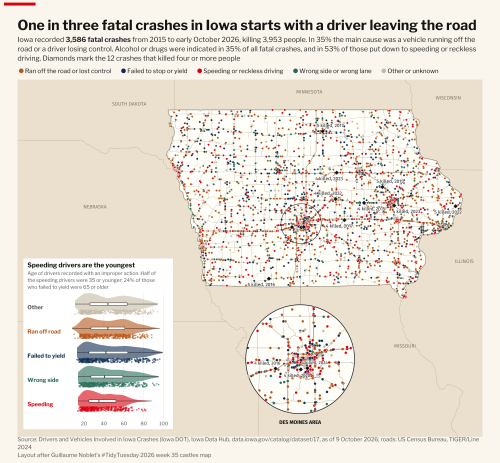

```r
source("R/iowa_fatal_crashes.R")   # writes output/iowa_fatal_crashes.png and output/iowa_fatal_crashes_thumb.png
```

The full dataset is 1.1 million rows and 717 MB, so the repo keeps a 0.9 MB extract of the fatal crashes.
`R/iowa_fatal_crashes_extract.R` rebuilds it from the download. The steps, definitions and checks are in
[docs/iowa_fatal_crashes.md](docs/iowa_fatal_crashes.md).

## Iowa fatal crashes by weekday

`R/iowa_fatal_crash_days.R` reworks Georgios Karamanis's
[daily accidents chart](https://github.com/gkaramanis/tidytuesday/blob/master/2025/2025-week_17/daily_accidents.R)
for the same fatal crashes, 2015 to 2025. One panel per weekday; each point is one weekday within one month, placed
by deaths per day and by how that compares with the 61-day average around it.

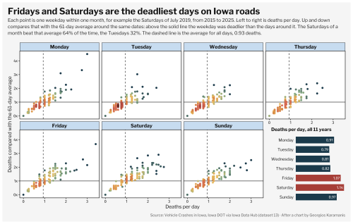

```r
source("R/iowa_fatal_crash_days.R")   # writes output/iowa_fatal_crash_days.png and output/iowa_fatal_crash_days_thumb.png
```

The crash dates come from a second dataset, [Vehicle Crashes in Iowa](https://data.iowa.gov/catalog/dataset/13);
`R/iowa_fatal_crash_dates_extract.R` rebuilds the 0.5 MB extract. What was changed from the original chart, and why,
is in [docs/iowa_fatal_crash_days.md](docs/iowa_fatal_crash_days.md).

## Iowa fatal crashes by date and time of day

`R/iowa_fatal_crash_hours.R` reworks Georgios Karamanis's
[Vesuvius chart](https://github.com/gkaramanis/tidytuesday/blob/master/2025/2025-week_20/vesuvius.R) for the same
fatal crashes, 2015 to 2025. Each crash is a point placed by date and by time of day, coloured by how crowded its
part of the chart is, over a band that shows the hours of darkness. Two small maps show where the crashes were.

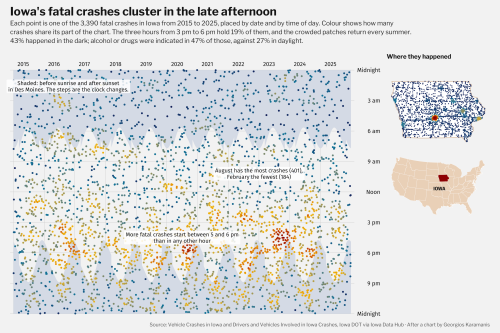

```r
source("R/iowa_fatal_crash_hours.R")   # writes output/iowa_fatal_crash_hours.png and output/iowa_fatal_crash_hours_thumb.png
```

It reads both crash extracts in `data/`. The mapping from the original chart, the sunrise formula and the checks
are in [docs/iowa_fatal_crash_hours.md](docs/iowa_fatal_crash_hours.md).

## Iowa fatal crashes: time of day by weekday

`R/iowa_fatal_crash_curves.R` reworks Georgios Karamanis's
[passport index chart](https://github.com/gkaramanis/tidytuesday/blob/master/2025/2025-week_37/passport_index.R)
for the same fatal crashes, 2015 to 2025. One density curve of the time of day per weekday, five in grey and the
two that differ most (Sunday and Tuesday) in colour, each with a note at its peak.

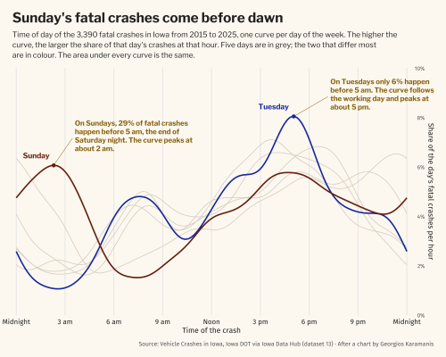

```r
source("R/iowa_fatal_crash_curves.R")   # writes output/iowa_fatal_crash_curves.png and output/iowa_fatal_crash_curves_thumb.png
```

Why the curves are weekdays and not years, and how the density handles midnight, is in
[docs/iowa_fatal_crash_curves.md](docs/iowa_fatal_crash_curves.md).

## Iowa road deaths day by day

`R/iowa_fatal_crash_calendar.R` reworks Georgios Karamanis's
[cranes chart](https://github.com/gkaramanis/tidytuesday/blob/master/2025/2025-week_40/cranes.R) for the same fatal
crashes, 2015 to 2025. One row per year and one column per month, with a bar for every day on which someone died.
July and August, the peak season, sit in a block on the left; a map and a short text separate them from the other
ten months.

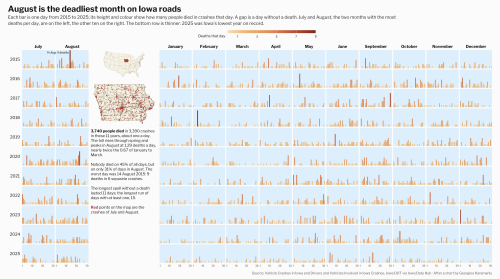

```r
source("R/iowa_fatal_crash_calendar.R")   # writes output/iowa_fatal_crash_calendar.png and output/iowa_fatal_crash_calendar_thumb.png
```

It reads both crash extracts in `data/`. The mapping from the original chart and the checks are in
[docs/iowa_fatal_crash_calendar.md](docs/iowa_fatal_crash_calendar.md).

## Iowa road death rates by district and county

`R/iowa_fatal_crash_districts.R` reworks Georgios Karamanis's
[SPI indicators chart](https://github.com/gkaramanis/tidytuesday/blob/master/2025/2025-week_48/spi_indicators.R)
for the same fatal crashes, 2015 to 2024. Left: road deaths per 100,000 residents in Iowa DOT's six districts, with
the Southwest highlighted. Right: one small panel for each of its 17 counties, drawn against the other 16.

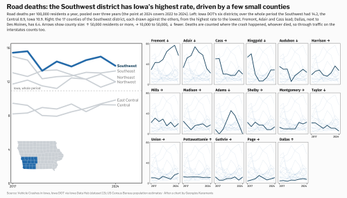

```r
source("R/iowa_fatal_crash_districts.R")   # writes output/iowa_fatal_crash_districts.png and output/iowa_fatal_crash_districts_thumb.png
```

It adds county population from the Census Bureau (`data/iowa_county_population_2015_2024.csv`, rebuilt by
`R/iowa_county_population_extract.R`). How the rate is defined and what it cannot say is in
[docs/iowa_fatal_crash_districts.md](docs/iowa_fatal_crash_districts.md).

## Iowa road death rates by county

`R/iowa_fatal_crash_counties.R` reworks Nicola Rennie's
[general health map](https://github.com/nrennie/data-viz-projects/blob/main/general-health/general-health-2021-census.R)
for the same fatal crashes, 2015 to 2024: one map of Iowa's 99 counties, each coloured by road deaths per 100,000
residents a year, with the interstates and US highways drawn on top.

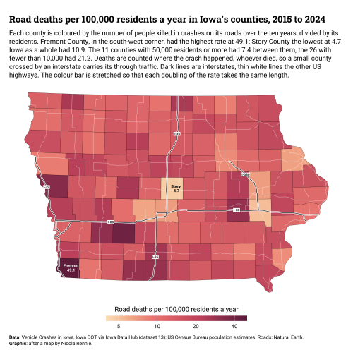

```r
source("R/iowa_fatal_crash_counties.R")   # writes output/iowa_fatal_crash_counties.png and output/iowa_fatal_crash_counties_thumb.png
```

It uses the same two data files as the districts chart. Why the colour bar is on a log scale and what the map
cannot say is in [docs/iowa_fatal_crash_counties.md](docs/iowa_fatal_crash_counties.md).

## Iowa fatal crashes as a contour map

`R/iowa_fatal_crash_contours.R` reworks Nicola Rennie's
[Forest of Bowland map](https://github.com/nrennie/data-viz-projects/blob/main/forest-of-bowland/forest-of-bowland.R).
The original draws the height of the land as filled contours. Here the surface is the number of fatal crashes per
1,000 km², 2015 to early October 2026, so the cities stand up as hills.

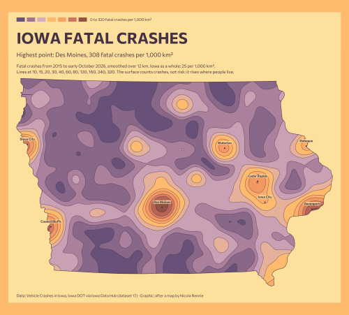

```r
source("R/iowa_fatal_crash_contours.R")   # writes output/iowa_fatal_crash_contours.png and output/iowa_fatal_crash_contours_thumb.png
```

It reads the extract with crash positions, `data/iowa_fatal_crashes_2026-10-09.csv`. How the surface is made from
points and what it cannot say is in [docs/iowa_fatal_crash_contours.md](docs/iowa_fatal_crash_contours.md).

## Iowa fatal crashes: driver age by vehicle

`R/iowa_fatal_crash_driver_ages.R` reworks Nicola Rennie's
[working hours ridgeline chart](https://github.com/nrennie/30DayChartChallenge/blob/main/2022/scripts/day_24.R)
for the drivers in Iowa's fatal crashes, 2015 to early October 2026. One density curve of driver age per vehicle
type, from passenger cars (median 35) down to farm machinery (median 58.5).

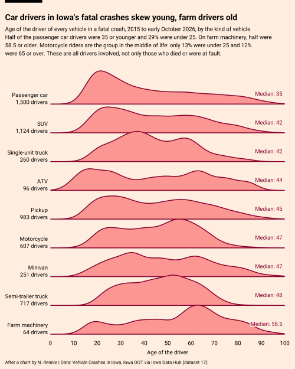

```r
source("R/iowa_fatal_crash_driver_ages.R")   # writes output/iowa_fatal_crash_driver_ages.png and output/iowa_fatal_crash_driver_ages_thumb.png
```

It reads `data/iowa_fatal_crashes_2026-10-09.csv`. Why the ridges are vehicle types and not years, and what the
chart cannot say, is in [docs/iowa_fatal_crash_driver_ages.md](docs/iowa_fatal_crash_driver_ages.md).

## Iowa road death rates by county size

`R/iowa_fatal_crash_county_sizes.R` reworks Nicola Rennie's
[teachers' salaries raincloud chart](https://github.com/nrennie/30DayChartChallenge/blob/main/2024/scripts/day_06.R).
Each of Iowa's 99 counties is a dot at its road deaths per 100,000 residents a year, 2015 to 2024, in four rows by
county size, with a density curve above each row and the median and spread on the line.

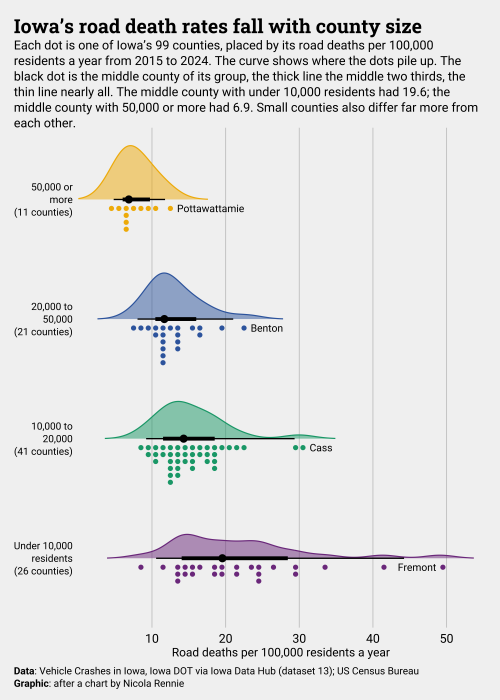

```r
source("R/iowa_fatal_crash_county_sizes.R")   # writes output/iowa_fatal_crash_county_sizes.png and output/iowa_fatal_crash_county_sizes_thumb.png
```

It uses the same two data files as the county map. How to read a raincloud and what this one cannot say is in
[docs/iowa_fatal_crash_county_sizes.md](docs/iowa_fatal_crash_county_sizes.md).

## Iowa road deaths in three periods

`R/iowa_fatal_crash_eras.R` reworks Nicola Rennie's
[income share chart](https://github.com/nrennie/30DayChartChallenge/blob/main/2025/scripts/day_23.R), which cuts
one time series into side-by-side panels with a smoothed line each. Here the series is Iowa's road deaths per
month, adjusted for the season, in three panels: 2015 to 2019, 2020 to 2024, and 2025, the lowest year on record.


```r
source("R/iowa_fatal_crash_eras.R")   # writes output/iowa_fatal_crash_eras.png and output/iowa_fatal_crash_eras_thumb.png
```

How the seasonal adjustment works, and why 2025 is a real low and not missing data, is in
[docs/iowa_fatal_crash_eras.md](docs/iowa_fatal_crash_eras.md).

## Iowa fatal crashes on the main roads

`R/iowa_fatal_crash_roads.R` reworks Nicola Rennie's
[London bus stops map](https://github.com/nrennie/30DayMapChallenge/blob/main/2022/scripts/day_11.R): red dots
over grey roads and nothing else. The dots are Iowa's 3,581 fatal crashes from 2015 to early October 2026; the
roads are the Census Bureau's primary and secondary roads. About half the crashes lie on those roads.

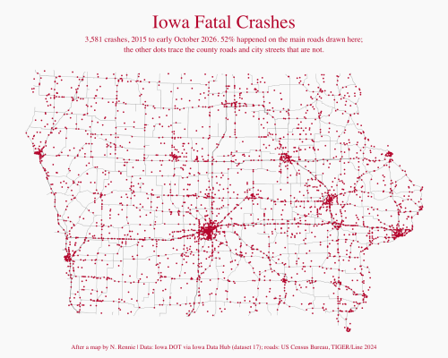

```r
source("R/iowa_fatal_crash_roads.R")   # writes output/iowa_fatal_crash_roads.png and output/iowa_fatal_crash_roads_thumb.png
```

Both inputs are in `data/`, so it runs offline. Where the roads come from and how "on a main road" is measured is
in [docs/iowa_fatal_crash_roads.md](docs/iowa_fatal_crash_roads.md).

## Iowa fatal crashes in hexagons

`R/iowa_fatal_crash_hexes.R` reworks Nicola Rennie's
[Deutschland hexagon map](https://github.com/nrennie/30DayMapChallenge/blob/main/2022/scripts/day_21.R). Iowa is
covered with hexagons 10 km across, each coloured by the number of fatal crashes in it from 2015 to early October
2026, pale for none and near-black for the 86 in the middle of Des Moines.

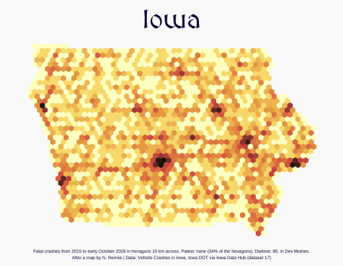

```r
source("R/iowa_fatal_crash_hexes.R")   # writes output/iowa_fatal_crash_hexes.png and output/iowa_fatal_crash_hexes_thumb.png
```

How the honeycomb is made and counted, and why the scale is pseudo-log, is in
[docs/iowa_fatal_crash_hexes.md](docs/iowa_fatal_crash_hexes.md).

## Iowa fatal crashes by vehicle type and weather

`R/iowa_fatal_crash_vehicles.R` reworks Georgios Karamanis's
[Brazilian companies chart](https://github.com/gkaramanis/tidytuesday/blob/master/2026/2026-week_05/brazilian_companies.R)
for the same fatal crashes, 2015 to 2025. One bar per vehicle type, filled to 100% and split by the weather at the
crash. Thicker bars are types with more crashes, and the bars are ordered by their share in clear weather.

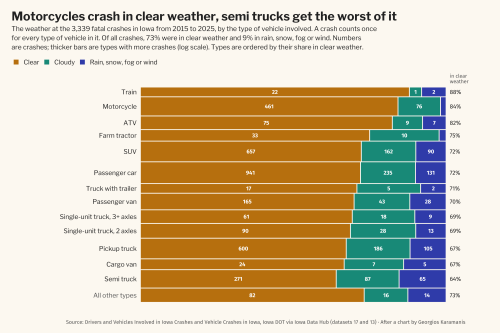

```r
source("R/iowa_fatal_crash_vehicles.R")   # writes output/iowa_fatal_crash_vehicles.png and output/iowa_fatal_crash_vehicles_thumb.png
```

It reads both crash extracts in `data/`. Why it counts crashes and not vehicles, and what the chart cannot say, is
in [docs/iowa_fatal_crash_vehicles.md](docs/iowa_fatal_crash_vehicles.md).
